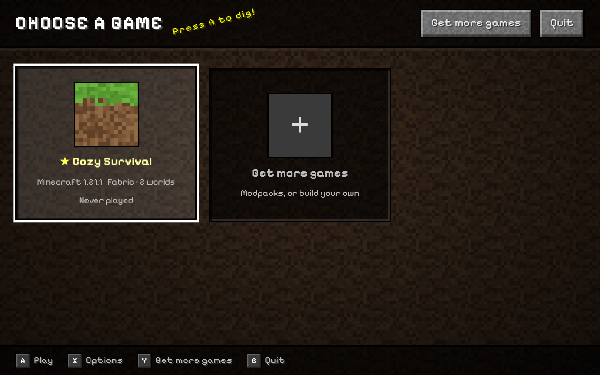
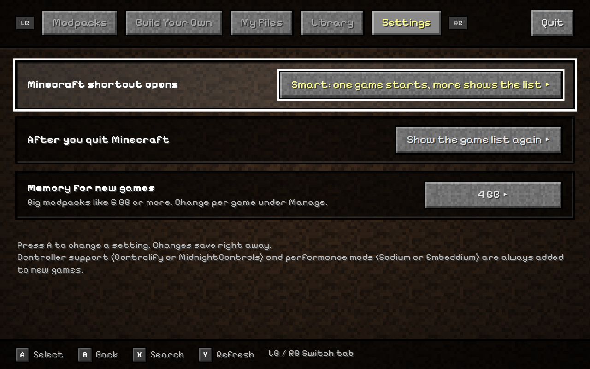
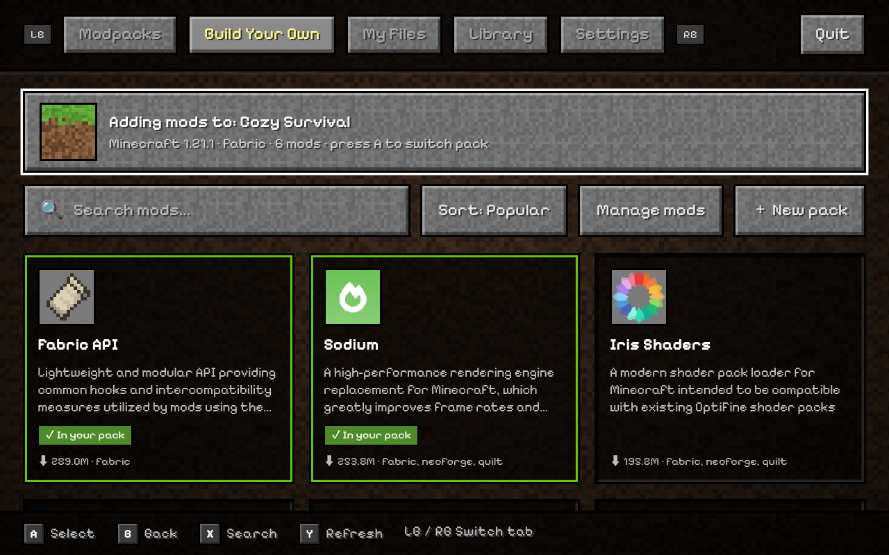
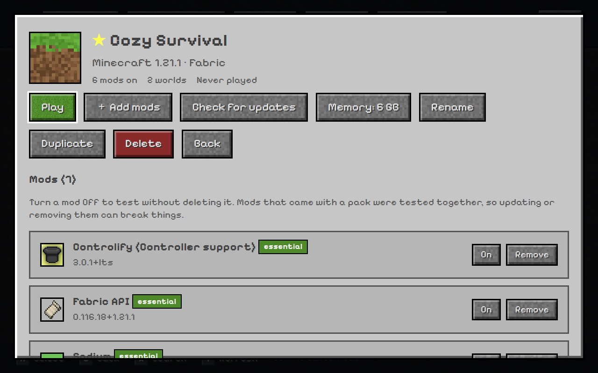
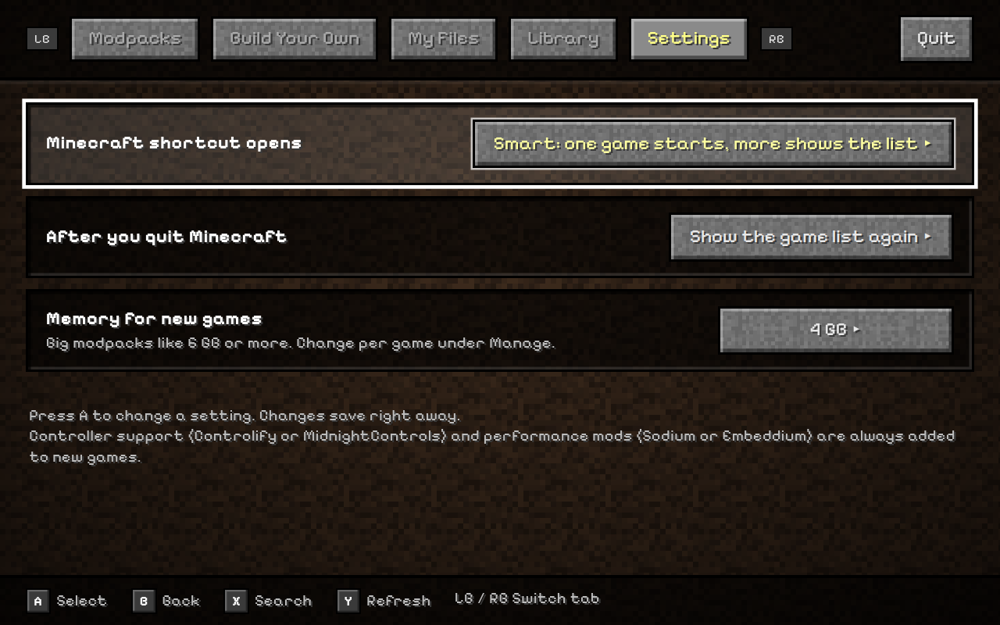

# Modpack Picker

A gamepad-first Minecraft: Java Edition launcher frontend for handheld PCs (ROG Ally, Steam Deck, Legion Go) and Steam Game Mode. Browse and install Modrinth modpacks, **build your own pack mod by mod**, manage your games, and pick what to play, all with a controller and no mouse or keyboard.

Under the hood it installs everything as normal [Prism Launcher](https://prismlauncher.org) instances, so you can still open and tweak them on the desktop.



## Features

**Get games**
- **Modpacks:** search Modrinth, sort (popular, best match, newest, recently updated, most followed), filter by loader, pick a version and install.
- **Build Your Own:** name a pack, pick a Minecraft version, then browse Modrinth mods that are already filtered to fit it. Press A to add one; required libraries come along automatically. Mods already in the pack are marked.
- **My Files:** install `.mrpack` files from `~/Downloads` or `~/Modpacks`.
- **Essentials on every game:** controller support (Controlify, or MidnightControls as a fallback) and a performance mod (Sodium, or Embeddium) are added unless the pack already has one.

**Manage games**
- Turn mods on or off without deleting them, or remove them.
- Check for mod updates and apply them in one go.
- Set memory per game (3 to 10 GB), rename, duplicate, or delete (deleted games go to the trash, so worlds can be recovered).
- See worlds, mods, last played and total play time at a glance.

**Play**
- A big-tile "Choose a game" screen, most recently played first. Press X on a tile for its options.
- Choose what the Minecraft shortcut does: start your only game or show the list, always show the list, start the last played game, or start your starred game.
- After quitting Minecraft, go back to Steam or straight back to the game list.
- The game runs in the foreground, so Steam tracks it properly, and Prism is set to hide while you play and quit when you are done.

**Controller friendly throughout:** an on-screen keyboard with shift, spatial D-pad navigation, LB/RB to switch tabs, right stick to scroll, and a UI that scales up on small high-resolution screens.

| Modpacks | Build Your Own |
|---|---|
|  |  |
| **Manage a game** | **Settings** |
|  |  |

## Requirements

- Linux with Flatpak
- [Prism Launcher](https://flathub.org/apps/org.prismlauncher.PrismLauncher) (Flatpak), opened once with a Microsoft account signed in
- Python 3.8 or newer (standard library only)
- A Chromium-based browser for the UI: Chromium (`org.chromium.Chromium`), Google Chrome, or Brave, as a Flatpak or a regular install

## Install

```sh
git clone https://github.com/taynotfound/modpack-picker.git
cd modpack-picker
./install.sh
```

This puts two entries in your app menu:

- **Minecraft** starts your game (or the game list, depending on Settings).
- **Modpack Picker** opens the full app.

For Steam Game Mode, add one or both as Non-Steam Games from desktop mode. Run `./install.sh` again to update and `./uninstall.sh` to remove (your Prism games and worlds are not touched).

## Controls

| Button | Action |
|---|---|
| D-pad / left stick | Move |
| A | Select |
| B | Back (quits from the game list) |
| X | Search; options on a game tile; backspace on the keyboard |
| Y | Refresh; "Get more games" on the game list |
| LB / RB | Switch tab |
| Start | Confirm the on-screen keyboard |
| Right stick | Scroll |

A keyboard works too: arrows, Enter, Esc, Q/E for tabs.

## How it works

- `bin/modpack-picker` starts a small local server (`share/server.py`, bound to `127.0.0.1` only) and opens the UI (`share/index.html`) in a kiosk browser window. When you choose a game it closes the UI and runs `flatpak run org.prismlauncher.PrismLauncher --launch <instance>` in the foreground.
- `bin/minecraft-handheld` is the Minecraft shortcut. It reads `~/.config/minecraft-handheld/settings.json` to decide whether to start a game straight away or show the list.
- Downloads come only from Modrinth's CDN (plus GitHub and GitLab for files that packs link to there) over HTTPS, and every file is checked against the SHA-512 or SHA-1 hash Modrinth publishes.
- Custom packs use Fabric, the loader with the most mods. Installed modpacks keep whatever loader they ship with (Fabric, Quilt, Forge or NeoForge).
- Prism's `CloseAfterLaunch` and `QuitAfterGameStop` settings are turned on the first time you launch a game, unless you have already set them yourself.

### Environment variables

| Variable | Default | Purpose |
|---|---|---|
| `MODPACK_PICKER_BROWSER` | auto | Flatpak app id or command for the UI browser |
| `MODPACK_PICKER_PORT` | `47823` | Local port for the UI server |
| `MODPACK_PICKER_DIR` | `~/.local/share/modpack-picker` | Where the app files live |
| `MINECRAFT_HANDHELD_DIRECT` | unset | `1` always starts the starred game |

### Steam Flatpak note

If Steam itself is a Flatpak, Non-Steam shortcuts run inside Steam's sandbox, which has no controller access for the browser and may lack a usable certificate store. The scripts hop out to the host through `hrun` when it is available (as on Anatase). On other setups, point the shortcut at `flatpak-spawn --host ~/.local/bin/minecraft-handheld` instead.

## Credits

- Mod and modpack data from the [Modrinth API](https://docs.modrinth.com/api/).
- [Pixelify Sans](https://github.com/eifetx/Pixelify-Sans) font, SIL Open Font License (see `share/fonts/OFL.txt`).
- All textures are drawn in code at runtime; no game assets are included.

Not an official Minecraft product. Not approved by or associated with Mojang or Microsoft. Not affiliated with Modrinth or Prism Launcher.

## License

MIT, see [LICENSE](LICENSE). The bundled font keeps its own OFL license.
